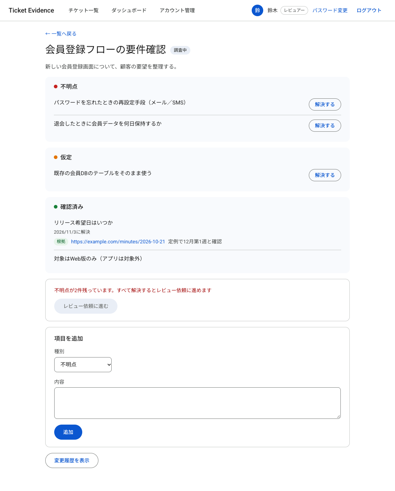
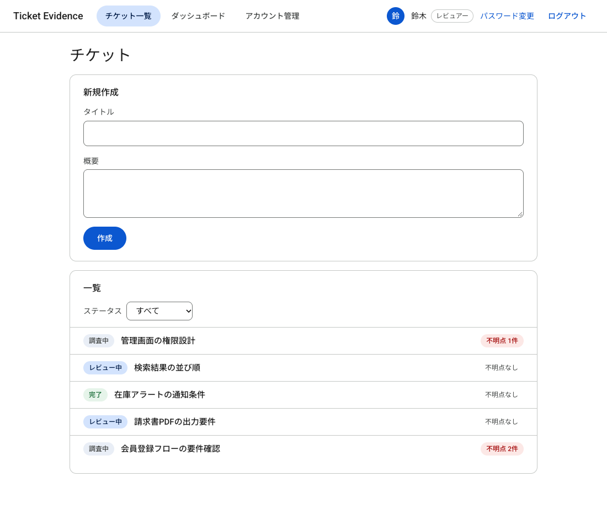
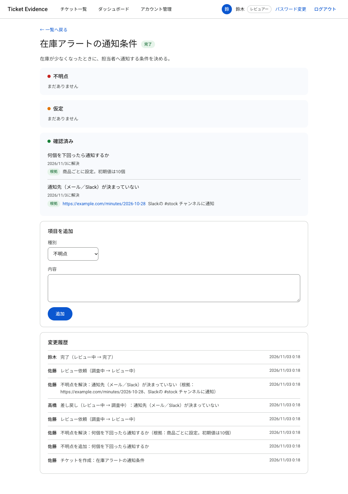
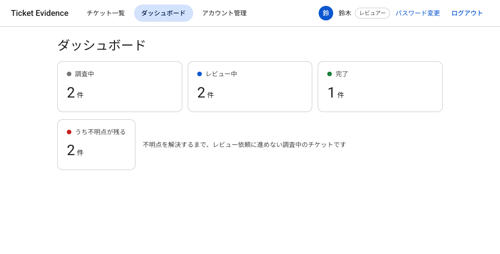
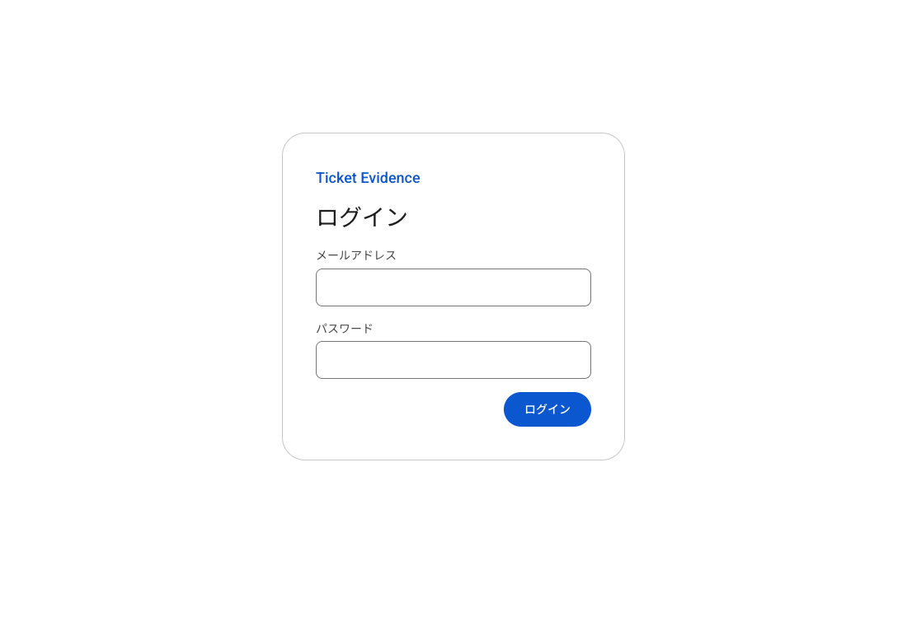
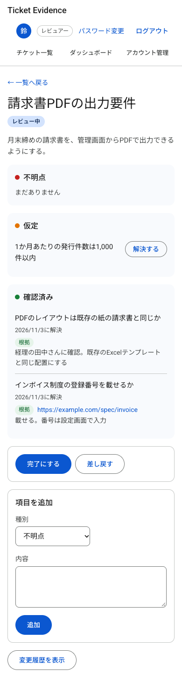

# Ticket Evidence

顧客の要件を調べて開発チケットにまとめるときに、**「確認済み」「不明点」「仮定」と、その根拠**を分けて残すためのアプリです。
根拠がないと項目を「確認済み」にできず、不明点が残っているとレビューに進めません。レビューで「それ、誰がどこで確認したの？」と聞かれても、その場で根拠を示せる状態をつくります。



## なぜ作ったか

要件をまとめる段階では、「顧客に確認したこと」と「たぶんこうだろうと思っていること」と「まだ分からないこと」が、チケットの説明文やコメントの中に混ざりがちです。その結果、

- 確認したはずのことの根拠（議事録・メール・仕様書）がたどれない
- 不明点が残ったままレビューや開発に進んでしまう
- 「この前提で進めた」という仮定が、受け取る側に伝わらない

ということが起きます。このアプリは、この3つを**仕組みで防ぐ**ことに絞って作りました。

## 主な機能とルール

| 機能 | ルール |
|---|---|
| 項目を「不明点」「仮定」「確認済み」に分けて追加 | — |
| 不明点・仮定を「解決する」 | **根拠（リンクかメモ）がないと解決できない**。解決すると確認済みに移る |
| レビュー依頼 | **不明点が1件でも残っていると進めない**（仮定は残っていてもよい） |
| 完了・差し戻し | **レビュアーだけ**ができ、**レビュー依頼した本人はできない** |
| 差し戻し | 理由が**不明点として追加**され、それを解決するまで再レビューに進めない |
| 変更履歴 | 誰が・何を・変更前後を、操作と同じトランザクションで記録 |
| 一覧・ダッシュボード | ステータスでの絞り込み、チケットごとの不明点の残数、不明点で止まっているチケット数 |
| アカウント管理 | 管理者がアカウントを作成し、仮パスワードを発行 |

ルールはすべて**APIの側（Service Object）**で守っていて、画面を通さずにAPIを直接呼んでも破れません。

## Redmineなどとの違い

汎用のチケット管理ツール（Redmine、Jiraなど）の代わりではなく、**開発チケットを登録する前の「要件を調べて固める段階」に特化したツール**です。

| 観点 | このアプリ | Redmine（標準の機能） |
|---|---|---|
| チケットの中身 | 確認済み・不明点・仮定を、種別を持った項目として扱う | 説明文と注記に自由に書く |
| 根拠 | 項目ごとに、解決するときに必須 | ステータス変更時にチケット単位で欄を必須にはできる |
| レビューに進む条件 | 不明点が残っていれば進めない | 子チケットや関連を組み合わせて運用で作る |
| 差し戻し | 理由が不明点になり、解決するまで再レビュー不可 | 注記に理由を書く |
| 依頼した本人の承認 | できない | 標準ではできない（プラグインが要る） |

Redmineでも、子チケットやカスタムフィールド、プラグインを組み合わせれば近いことはできます。違いは「できるかどうか」ではなく、**最初からその形に設計されていて、ルールが外れないこと**です。逆に、プロジェクト管理、通知、添付ファイル、検索などの機能はRedmineのほうがずっと充実しています。このアプリは機能を増やさず、シンプルに保つ方針です。

## 画面

| チケット一覧 | 差し戻しから完了までの変更履歴 |
|---|---|
|  |  |

| ダッシュボード | ログイン | スマホ |
|---|---|---|
|  |  |  |

## 公開

[Render](https://render.com/) で公開する設定（[render.yaml](render.yaml)、[Dockerfile.production](Dockerfile.production)）を用意しています。画面とAPIは1つのサービスで配信します。

公開するデモは、誰でもログインできる前提で次のようにしています。

- データは毎日リセットされます（`bin/rails demo:reset` を Cron Job で実行）
- パスワード変更と仮パスワードの発行は使えません（`DEMO_MODE=1`）

## 技術構成

| | |
|---|---|
| バックエンド | Ruby 3.3 / Rails 8.1（APIモード）/ PostgreSQL 16 |
| フロントエンド | React 19 / TypeScript / Vite 5 / React Router 7 |
| テスト | RSpec（リクエスト・モデル・サービス）、Vitest + Testing Library |
| CI | GitHub Actions：RSpec、Brakeman、bundler-audit、ESLint、型チェックとビルド、Vitest、npm audit |
| 開発環境 | Docker Compose |

UIライブラリは使わず、Material Design 3 の考え方に寄せたCSSを、色・余白・角丸のトークンから組み立てています（ダークモード対応）。

## 設計で考えたこと

詳しくは [docs/design.md](docs/design.md) に、「決めたこと・理由・他の選択肢」の形でまとめています。主なもの：

- **ルールはService Objectに置く**：レビュー依頼・完了・差し戻し・解決は、それぞれ1つのService Objectで、対象をロックしてから判断します。同時に操作されても二重に処理しません。
- **変更履歴は操作と同じトランザクションで記録**：操作だけ成功して履歴が残らない、ということを起こしません。変更前後は jsonb に入れます。
- **ログインはCookieのセッションをDBに記録**：ログアウトやパスワード変更で、サーバー側からセッションを無効にできます（盗まれたCookieの使い回しを防ぐ）。期限は無操作2時間・最長12時間です。
- **CSRF対策**：JSON以外の変更系リクエストを断り、CORSを許可しない構成で、ほかのサイトからの操作を防いでいます。CookieはSameSite=Lax・HttpOnlyです。
- **ログイン試行の制限**：IPごとと、メールアドレスごとの両方で回数を制限しています。
- **テストを先に書く**：機能はテストを先に書いて失敗を確かめてから実装する流れで作りました（RSpec 125件、Vitest 61件）。

## 動かし方

Docker が必要です。

```bash
git clone https://github.com/s1ros75/ticket-evidence.git
cd ticket-evidence
docker compose up -d
docker compose exec backend bin/rails db:prepare
docker compose exec backend bin/rails db:seed   # デモ用のアカウントとチケットを作る
```

http://localhost:5173 を開き、次のアカウントでログインします（パスワードはすべて `password1234`）。

| メールアドレス | 名前 | ロール |
|---|---|---|
| `member@example.com` | 佐藤 | 担当者 |
| `reviewer@example.com` | 鈴木 | レビュアー・管理者 |
| `reviewer2@example.com` | 高橋 | レビュアー |

レビュアーが2人いるので、「依頼した本人は完了できない」ルールも試せます（鈴木が依頼した「検索結果の並び順」は、高橋でログインすると完了・差し戻しができます）。

### テスト

```bash
# バックエンド
docker compose run --rm -e RAILS_ENV=test \
  -e DATABASE_URL=postgres://postgres:password@db:5432/ticket_evidence_test \
  backend sh -c "bin/rails db:create db:schema:load && bundle exec rspec"

# フロントエンド
cd frontend && npm ci && npm test
```

## 作らなかったもの

チケットごとの担当者、添付ファイル、通知、全文検索、メールでのパスワード再設定などは、意図して作っていません（理由は [docs/design.md](docs/design.md) の「作らなかったもの」）。
